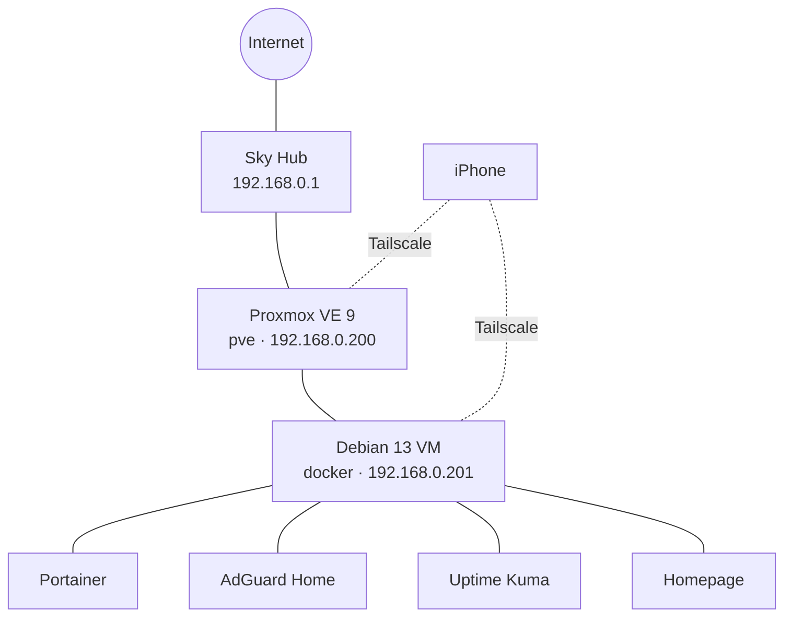

# homelab

My self-hosted home server, built on an old gaming laptop. It runs my own apps, blocks ads for every device I own, and lets me reach everything securely from anywhere, with no ports opened on my router.

I'm building it alongside my Software Engineering degree apprenticeship to learn Linux, networking, Docker and DevOps by running real services I use every day.

## Hardware

| Part | Details |
| --- | --- |
| Server | MSI GP65 Leopard laptop (Intel Core i7, RTX 2070), running headless with the lid shut |
| Network | Sky Broadband Hub, laptop wired by Ethernet |
| Backup power | The laptop's own battery |

## How it fits together



- **Proxmox VE** runs on the laptop and hosts virtual machines.
- A **Debian VM** runs every app in Docker, so the Proxmox host itself stays clean.
- **Tailscale** connects my devices to the server from anywhere, and sends their DNS through AdGuard, so ads are blocked at home and on mobile data.

## Services

| Service | What it does | Port |
| --- | --- | --- |
| [Portainer](portainer/compose.yaml) | Web UI for managing Docker containers | 9443 |
| [AdGuard Home](adguard/compose.yaml) | Network-wide ad and tracker blocking (DNS) | 53, 8080 |
| [Uptime Kuma](uptime-kuma/compose.yaml) | Checks every service each minute and alerts my phone via ntfy | 3001 |
| [Homepage](homepage/compose.yaml) | Dashboard linking to everything | 3002 |

## Repo layout

```
homelab/
├── adguard/compose.yaml
├── homepage/
│   ├── compose.yaml
│   └── config/services.yaml
├── portainer/compose.yaml
└── uptime-kuma/compose.yaml
```

Each app has its own folder with a `compose.yaml`. Data and secrets live in Docker volumes or git-ignored folders, never in this repo.

## Running it

```bash
cd <app-folder>
docker compose up -d      # start or update
docker compose logs -f    # watch logs
docker compose down       # stop
```

## Backups

- Proxmox backs up the whole Docker VM every night at 03:00 (snapshot mode, last 3 kept).
- Restores are tested: I've restored a backup to a new VM to prove it works.
- **Next:** copy backups to an external drive so they survive the laptop failing.

## Lessons learned

- **Check the cable before installing.** The Proxmox installer couldn't reach my router, so it picked a default address (`192.168.100.2`) on the wrong network. I fixed it by editing `/etc/network/interfaces` and `/etc/hosts`.
- **VMs don't start on boot by default.** After a reboot my Docker VM stayed off, which took DNS (and so the internet) down for every device using AdGuard. Fixed with Proxmox's "Start at boot" option.
- **DNS is a single point of failure.** If AdGuard is down, devices pointed at it lose the internet. Uptime Kuma now has a DNS check that alerts me.

## Roadmap

- [x] **Phase 1:** Proxmox, Docker, ad blocking, remote access, monitoring, backups
- [ ] **Phase 2:** own domain, Cloudflare Tunnel, Coolify, self-hosting my projects
- [ ] **Phase 3:** NAS with mirrored drives, off-site backups, UPS
- [ ] **Phase 4:** VLANs, managed switch, Active Directory lab, security monitoring
- [ ] **Phase 5:** Terraform and Ansible, so the whole lab can be rebuilt from code
